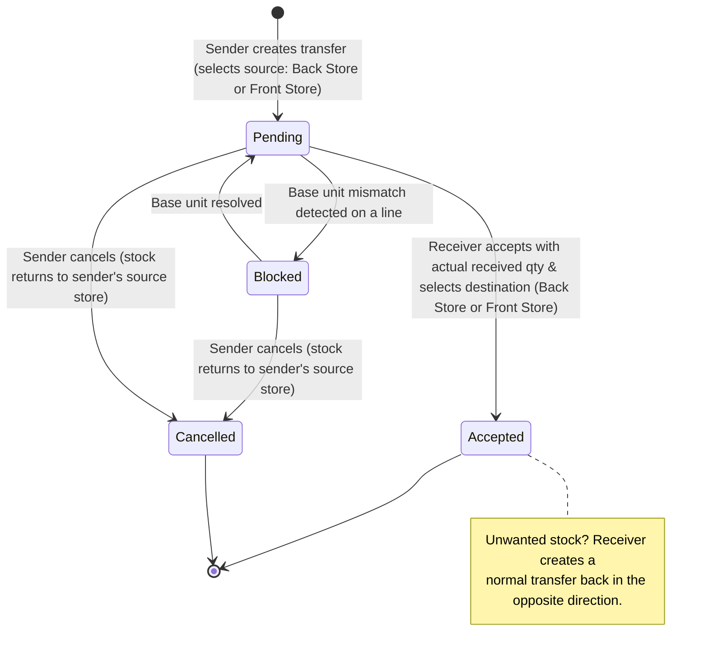

# AGENT README — Inter-Branch Product Linking & Stock Transfers (Warehouse-Style Movement)

> [!IMPORTANT]
> **STATUS: IMPLEMENTED & TESTED (PRODUCTION-READY).**
> All phases (Phases 1–9) have been carefully executed, migrated, wired, and verified with 100% passing automated feature tests.

> [!CAUTION]
> **Production Safety Rule:** The project is live. **Never edit existing migration files.** All schema changes must be new timestamped migrations (`php artisan make:migration ...`).

---

## 1. Background & Goal

A client asked about "warehouses for branches". The real need: **move stock between any of an organization's branches (any-to-any)**, where each branch keeps its **own independent item catalog** (its own `items` rows, prices, barcodes).

The difficulty: Branch A's "Peak Milk" and Branch B's "Peak Milk" are **different item records**. Before stock can move, the system must know which item in the receiving branch corresponds to the sender's item. That mapping is called a **link**.

This feature introduces:

1. **Product Groups** — an organization-wide way to link "the same product" across branches.
2. **Product Links screen** — an organization-level grid for linking items in bulk.
3. **Transfer + Receiving Queue** — pending → accept workflow for moving stock, which also links items on the fly.

---

## 2. Core Concept: Shared Product Groups (not branch-to-branch pairs)

| Approach | Links needed per product (4 branches) | (10 branches) |
| :--- | :--- | :--- |
| Branch-to-branch pairs | 6 | 45 |
| **Shared product group (chosen)** | **4 (one join per branch)** | **10** |

- Each real-world product gets **one Product Group** scoped to an organization.
- Each branch's item **joins** that group.
- Any branch can then transfer to any other branch in the group with **no matching at transfer time**.
- **Safety rule (hard constraint):** **one item per branch per group.**

### Proposed data model (indicative — finalize at build time)

```text
product_groups
  id, organization_id, name, created_by, timestamps

product_group_items
  id, product_group_id, branch_id, item_id, linked_by, link_source, timestamps
  UNIQUE (product_group_id, branch_id)   -- one item per branch per group
  UNIQUE (item_id)                       -- an item belongs to at most one group

product_link_logs        -- audit trail of link / unlink / merge / bulk operations
  id, organization_id, action, payload (json), batch_id, user_id, timestamps

stock_transfers (inter-branch transfer fields)
  id, reference, source_branch_id, destination_branch_id,
  from_location ('back_store' | 'front_store'),       -- chosen by sender at creation
  to_location ('back_store' | 'front_store' | null),  -- chosen by receiver at acceptance
  status ('pending', 'blocked', 'accepted', 'cancelled'),
  created_by, accepted_by, timestamps
```

`link_source` values: `manual`, `auto_barcode`, `auto_name_confirmed`, `copy`, `receiving_queue`.

---

## 3. Product Links Screen (Organization Level)

A grid: **one row per product group, one column per branch.** Each cell shows that branch's linked item, or is empty.

Each cell must also display the item's **base unit** (see §8.2).

### 3.1 Actions

| Action | Behaviour |
| :--- | :--- |
| **Auto-suggest** | Pick a "template" branch (default: fullest catalog). System proposes matches in every other branch — **exact barcode first, similar name second**. Barcode matches can be **bulk-confirmed in one click**; name matches must be **reviewed by hand**. Never auto-links without confirmation. |
| **Link manually** | Pick an item, then its match in each other branch; or add an unlinked item to an existing group. |
| **Unlink** | Remove an item from its group (affects future transfers only). |
| **Merge groups** | If two groups are the same product, merge them. If both have an item in the same branch, the screen asks which to keep (usually indicates a duplicate item in that branch). |
| **Filter** | Unlinked items per branch · products missing from some branches · possible conflicts (duplicates, base-unit mismatch). |
| **Create in other branches** | For a product a branch does not stock yet: copy the item into that branch and link it in one step (see §4). |
| **Undo bulk operation** | Every bulk link run gets a `batch_id`; the whole batch can be reverted. |

### 3.2 Auto-suggest matching rules

- Compare each candidate item against **every member of each group**, not just the template item, so barcodes/names that differ between branches can still match.
- If a branch has **two items matching the same group**, the screen asks which one to link; the other stays unlinked.
- Items that match nothing stay unlinked; user may leave them or start a new group.

### 3.3 Access control

| Role | Access |
| :--- | :--- |
| **Platform Super Admin** | Full screen, from inside the organization screens. **Available first.** |
| **Organization Admin** | **Full screen** (confirmed requirement), behind a dedicated permission. Depends on Organization Layer Phases 4 & 6 — until those ship, Super Admin only. |
| **Branch Admin** | **No** access to the full screen. Links only via the **Receiving Queue**, and only touches **their own branch's** items. No branch can change another branch's catalog. |

---

## 4. "Create in Other Branches" (Copy) — With Prices

Confirmed: **prices should be copied where possible.**

- Checkbox **"Include prices"** — **default ON**.
- UI must clearly state: **"Copied once, not synced."** After copy, each branch's prices are independent.

### 4.1 What is copied

| Copied | Not copied |
| :--- | :--- |
| Name, category, units, barcode | Stock quantities |
| Base unit **cost**, **selling**, **wholesale** price (if "Include prices") | Item discounts / group discounts / promotions (time-limited, branch-specific) |
| Each variant's own selling & wholesale price (if "Include prices") | Batches, IMEIs |

### 4.2 Profit-percentage pricing interaction

If the **destination branch has profit-percentage pricing enabled**, copy **only the cost price** and let the destination's own percentage calculate selling and wholesale prices. Otherwise the copied selling price would be immediately overridden.

---

## 5. Transfer Workflow (Pending → Accept, No Reject Button)

Confirmed by product owner:
- **No reject button:** pending → accept; unwanted stock is sent back via a return transfer.
- **Store Location Flexibility (Any-to-Any):** stock can move from **either Back Store or Front Store** at the sender branch to **either Back Store or Front Store** at the destination branch.



### 5.1 Rules

1. **Pending until accepted & source store selection.** When creating the transfer, the sender chooses whether stock is drawn from **Back Store** (`back_store_qty`) or **Front Store** (`front_store_qty`) (default: Back Store). Stock is immediately deducted from that chosen location's balance on creation and is held "in transit" until accepted.
2. **Sender can cancel while Pending.** Returns stock directly to the **originating location** (the sender's Back Store or Front Store where it was originally drawn from). Prevents stock being invisible or misallocated in both branches.
3. **Receiver enters actual quantity received & chooses destination store.** On acceptance:
   - Receiver selects whether to deposit the incoming stock into their **Back Store** (`back_store_qty`) or **Front Store** (`front_store_qty`) (default: Back Store).
   - Receiver enters the actual quantity counted.
   - If it differs from the sent quantity, the shortfall is recorded as a **discrepancy** and flagged via **Notifications** (same pattern as existing stock conflicts).
   - The shortfall does **not** auto-return. The sender or an admin resolves it.
4. **After acceptance**, only a **return transfer** (opposite direction) can undo it. Audit trail stays clean: one transfer out, one transfer back.
5. **Stale pending reminder (max 5 days):** a transfer must not sit pending longer than **5 days** without action. Reminders go to the receiver (and sender) as it ages, with a final escalation to the sender and Org/Super Admin at day 5. The threshold is configurable per organization but **cannot exceed 5 days**. No auto-cancel: stock stays in transit until the sender cancels or the receiver accepts.
6. **Base unit mismatch blocks acceptance:** if any line links items whose base units differ, the transfer shows as **Blocked (pending)** and the Accept button is disabled. Once the base unit is resolved (an admin corrects the item's base unit, or the link is fixed), the transfer returns to Pending and can be accepted. The sender can still cancel while it is blocked.
7. **Receiving branch keeps its own cost price:** accepting stock never changes the receiving item's cost, selling or wholesale price.

### 5.2 Receiving Queue (linking on the fly)

When a transfer arrives containing an item the receiving branch has **not** linked yet, the Branch Admin can, from the queue:

- Pick an existing item in their branch to link to the group, **or**
- Create the item in their branch from the sender's item (copy, §4), **or**
- (Later) leave it for an Org Admin to resolve.

The group grows each time. **The client does not need to finish linking before using transfers.**

---

## 6. Adding a New Branch to Already-Linked Branches

Example: branches 1–4 are linked, branch 5 is added. **Branches 1–4 are not re-linked** — branch 5 simply joins existing groups. Three methods (can be mixed):

1. **Copy from an existing branch** — "Create in other branches" using any linked branch as template. Creates items in branch 5 (with prices if checked) and links them in one step.
2. **Auto-suggest for branch 5** — if branch 5 already has its own catalog. Bulk-confirm exact barcode matches; review name matches.
3. **Do nothing** — the Receiving Queue links items one by one as transfers arrive. Branch 5 can receive stock immediately.

---

## 7. Branch Moving to Another Organization

Links are **organization-wide**, so links must not survive a move (otherwise one client's branch could connect to another client's catalog).

- Unlinking happens **inside the "Move branch" action itself** — not optional, cannot be forgotten.
- **Pre-condition:** all **pending transfers** involving that branch must be **completed or cancelled** before the move is allowed.
- After the move, the branch can be linked into its new organization via the same Product Links screen (copy-with-prices makes this quick).
- Log the unlink operation in `product_link_logs`.

> [!NOTE]
> **DECIDED (§12-A):** Only the **moved branch's items** are unlinked. The remaining branches in the old organization **keep their links** to each other.

---

## 8. Risks & Negative Effects (Most Serious First)

| # | Risk | Mitigation |
| :--- | :--- | :--- |
| 1 | **Wrong link moves real stock into the wrong product.** Unlinking fixes future transfers but does not undo stock already moved. | Never auto-link; only bulk-confirm **exact barcode** matches; log every link; allow undoing a whole bulk-link batch; manual stock correction for already-moved stock. |
| 2 | **Base unit mismatch.** "Send 10" = 10 sachets in Branch A but 10 rolls in Branch B. | Show base unit next to each item on the screen and warn on linking. Transfers with a mismatched line are **Blocked (pending)** and cannot be accepted until the base unit is resolved (§5.1 rule 6). |
| 3 | **Stock in transit invisible in both branches.** Stock/valuation reports dip; AI reorder prediction may wrongly flag sender as low. | Report "In Transit" separately; include it in organization totals; exclude from reorder-trigger calculations appropriately. |
| 4 | **Cost & profit.** Destination keeps its own cost, so profit on received stock can differ slightly from the sender's actual cost. | **Decided:** receiving branch keeps its own cost price (§12-B). Accepted trade-off; selling prices are never shifted by transfers. |
| 5 | **Distorted reports.** | Transfers must be their **own movement type** — not a sale, purchase, or stock adjustment. |
| 6 | **Offline tills & stock collision.** | Transfers can draw from either **Back Store** or **Front Store**. If drawn from Front Store, stock is deducted immediately in the database to prevent till overselling. If Back Store is chosen, front-store till sales are completely unaffected. On receipt, placing stock in Back Store prevents it from being sold before inspection; placing in Front Store makes it immediately available on shelves/POS. |
| 7 | **IMEI & batches.** | IMEIs keep per-branch uniqueness and history. Batch data only moves when users use the checkbox/modal; some drift accepted (already accepted for batches). |
| 8 | **Price expectations.** Copied prices drift apart afterward. | UI label: **"Copied once, not synced."** |
| 9 | **Messy catalogs.** Duplicate items in one branch block linking; name suggestions can be wrong (Milo 200g vs 400g). | Conflict filter; name matches always manual review. |
| 10 | **Build cost.** New stock-changing path on a live inventory system. | All stock changes go through the **existing stock adjustment logic**. Gated to **Silver upwards** (§12-F). |
| 11 | **Stuck transfers** if receivers ignore the queue. | Stale-pending reminders + sender cancel. |

None of these is a reason not to build. **Items 1–4 must be settled before implementation.**

---

## 9. Integration Notes (Existing System)

- **Existing stock transfers:** the codebase already has `StockTransferController` and inter-branch transfer accounting (`InventoryPostingService` posts Inter-Branch Receivable 1300 / Payable 2200). Review and extend rather than duplicate.
- **Accounting (decided, §12-G): post on both creation and acceptance**, each branch posting its own side when it acts:

  | Event | Branch | Debit | Credit | Amount |
  | :--- | :--- | :--- | :--- | :--- |
  | Transfer **created** | Sender | 1300 Inter-Branch Receivable | 1200 Inventory | Sent qty × sender cost |
  | Transfer **cancelled** | Sender | Reversal of the creation entry | | Sent qty × sender cost |
  | Transfer **accepted** | Receiver | 1200 Inventory | 2200 Inter-Branch Payable | Received qty × sender cost |
  | Shortfall **resolved as loss** | Sender | 5100 Shrinkage / Write-off | 1300 Inter-Branch Receivable | Shortfall qty × sender cost |

  - Why: the sender's books are right the moment stock leaves, and the receiver only records stock it actually counted. While pending, the value sits in the sender's 1300, which also serves as the "in transit" figure.
  - The GL uses the **sender's cost** for the value moved, so 1300 and 2200 reconcile across branches. The receiving **item's** cost price is still not changed (§12-B), so later COGS uses the receiver's own cost. This small difference is an accepted trade-off.
  - Branches without accounting simply skip their side; the stock movement still happens.
- **Notifications:** reuse the stock-conflict notification pattern for discrepancies and stale-pending reminders.
- **Plan gating (decided, §12-F):** Add capability flag `feature_inter_branch_transfers` via a **new migration** on `plan_capabilities`. Default `false` for Starter and Bronze; `true` for Silver, Gold, and Enterprise (matching the accounting tier).
- **Organization Layer:** Org Admin access depends on Organization Layer Phases 4 & 6 (see `AGENT_README_ORGANIZATION_LAYER.md`).

---

## 10. Future Enhancements (Enabled by Groups)

- Show **"Branch B has 40 of this"** inside a transfer form or report.
- Organization-wide stock view per product group.
- Suggest which branch should send stock when one branch is low.

---

## 11. Build Phases & Execution Status

1. ✅ **Schema** — Single timestamped migration (`2026_10_16_234500_create_inter_branch_product_linking_and_transfers_tables.php`) creating `product_groups`, `product_group_items`, `product_link_logs`, `inter_branch_transfers`, `inter_branch_transfer_items`, and adding `feature_inter_branch_transfers` to `plan_capabilities`.
2. ✅ **Linking service & models** — `ProductLinkingService` and Eloquent models (`ProductGroup`, `ProductGroupItem`, `ProductLinkLog`, `InterBranchTransfer`, `InterBranchTransferItem`). Full support for link, unlink, merge, auto-suggest (exact barcode & similar name), bulk-confirm with batch ID, undo batch, and copy-to-branches with prices.
3. ✅ **Product Links screen** — SuperAdmin organization matrix grid (`SuperAdmin/Organizations/ProductLinks.vue`) with auto-suggest modal, copy-to-branches modal, merge modal, undo modal, filter by incomplete/complete/conflicts, and health badges.
4. ✅ **Transfer workflow** — `InterBranchTransferService` with stock deduction from Back Store or Front Store, transit tracking, pending/cancelled states, and automatic base-unit mismatch detection setting transfer to `blocked`.
5. ✅ **Receiving Queue** — Branch Admin receiving queue & dispatched transfers (`Inventory/InterBranchTransfers/Index.vue` & `Create.vue`) with destination store selection (Back Store or Front Store), discrepancy shortfall logging, and on-the-fly linking/copying.
6. ✅ **Branch move hook & reminders** — `BranchController::moveOrganization` blocks moves if pending/blocked transfers exist, and unlinks only the moved branch's items upon move. Artisan command `php artisan transfers:check-stale` dispatches day-2 reminders and day-5 escalations.
7. ✅ **Accounting integration** — `InventoryPostingService::postStockTransferOut`, `reverseStockTransferOut`, and `postStockTransferIn` (Dr 1300 / Cr 1200 on creation, reversed on cancellation, Dr 1200 / Cr 2200 on receipt).
8. ✅ **Reports & Navigation** — Inter-Branch Transfers menu added to POS Layout under Inventory; in-transit metrics added to Organization Executive Dashboard.
9. ✅ **Tests** — 9 comprehensive feature tests in `Tests\Feature\InterBranchProductLinkingAndTransfersTest` passing with 47 assertions.

---

## 12. Decisions

| ID | Question | Status | Decision |
| :--- | :--- | :--- | :--- |
| **A** | On branch move: unlink only the moved branch, or all remaining branches too? | ✅ Decided | **Unlink only the moved branch.** Remaining branches keep their links. |
| **B** | Cost on receipt: keep own cost or weighted average? | ✅ Decided | **Receiving branch keeps its own cost price.** |
| **C** | Do this client's branches use the same base unit per product? | ✅ Covered by D | Mismatches are caught and blocked, so either case is safe. |
| **D** | Base-unit mismatch handling? | ✅ Decided | **Transfer is Blocked (pending)** and cannot be accepted until the base unit is resolved. |
| **E** | How long can a transfer stay pending? | ✅ Decided | **Max 5 days**, with reminders and day-5 escalation. Configurable per org, never above 5 days. No auto-cancel. |
| **F** | Plan gating: which plan(s) include this, or custom quote only? | ✅ Decided | **Silver upwards** (Silver, Gold, Enterprise). Default `false` on Starter & Bronze; `true` on Silver, Gold, Enterprise. |
| **G** | Accounting timing? | ✅ Decided | **Both:** sender posts at creation, receiver posts at acceptance (§9). |
| **H** | Store locations: Back Store vs Front Store? | ✅ Decided | **Full flexibility (either store to either store).** Sender selects source (Back Store or Front Store); receiver selects destination (Back Store or Front Store). Cancellations return stock to the originating store. |

---

## 13. Confirmed Decisions (From Discussion)

- ✅ Shared product groups; one item per branch per group.
- ✅ Dedicated organization-level Product Links screen.
- ✅ No reject button — pending → accept; unwanted stock is sent back via a return transfer.
- ✅ Sender can cancel while pending.
- ✅ Receiver records actual received quantity; shortfall flagged as discrepancy.
- ✅ New branches join existing groups (copy / auto-suggest / receiving queue).
- ✅ Copy includes prices (checkbox, default on), one-time copy.
- ✅ Branch moving organization: only the moved branch's items are unlinked; pending transfers must be completed or cancelled first.
- ✅ Receiving branch keeps its own cost price.
- ✅ Base unit mismatch keeps the transfer Blocked (pending) until resolved.
- ✅ Pending transfers: max 5 days, with reminders and escalation.
- ✅ Accounting posts on both creation (sender) and acceptance (receiver).
- ✅ Organization Admin gets the full linking screen (permission-based, after Org Layer phases).
- ✅ Branch Admin limited to Receiving Queue and own-branch items.
- ✅ Plan gating: enabled for **Silver upwards** (Silver, Gold, Enterprise) via `feature_inter_branch_transfers`.
- ✅ Store location flexibility: items can be moved from either Back Store or Front Store to either Back Store or Front Store at the destination.
